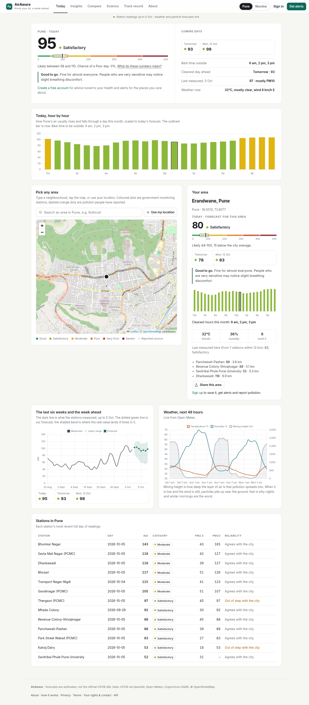
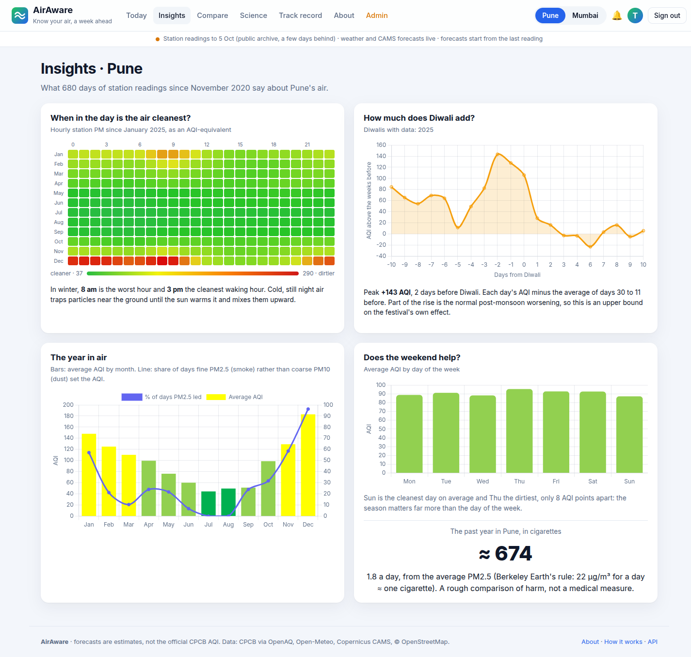
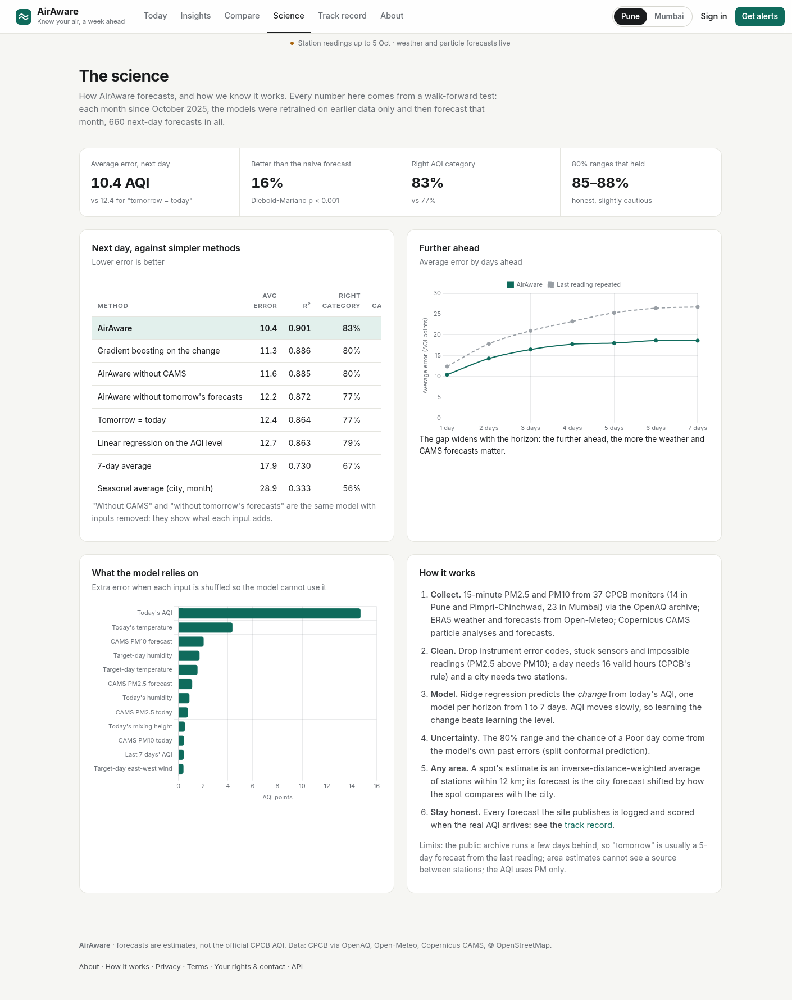
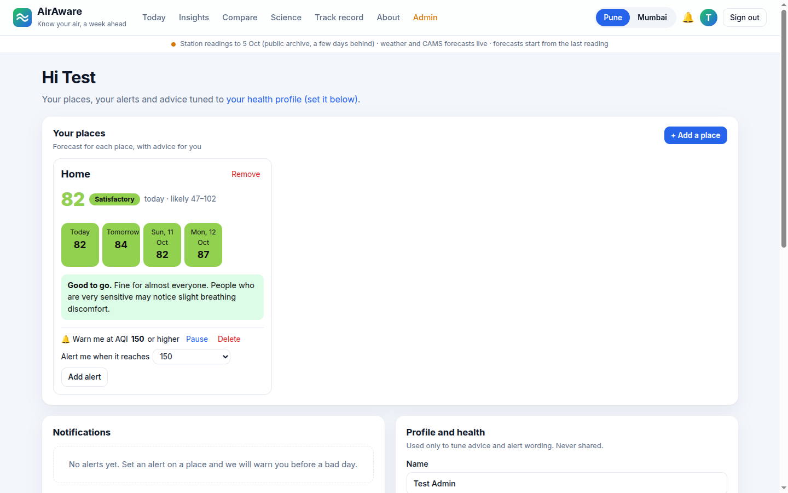
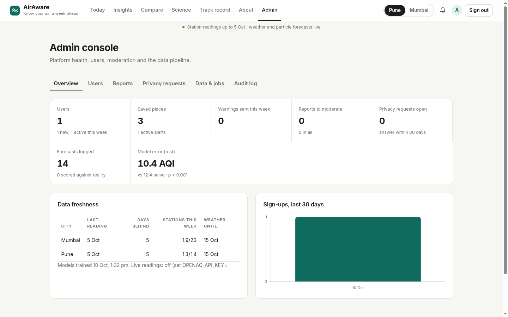
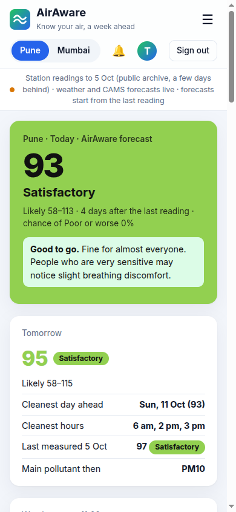

# AirAware

**Know your air, a week ahead.** A full-stack platform that forecasts air quality for any street in **Pune** and
**Mumbai** up to seven days ahead, from 37 government (CPCB) monitoring stations, live weather and the Copernicus CAMS
particle forecast. People sign up to save their places, get advice tuned to their health and an alert before a bad
day, and report pollution sources; admins moderate reports, manage users and watch the data pipeline.

DS/ML mini project (fits *Weather Data Analysis and Prediction System*) built as a portfolio product.

| | |
|---|---|
| Next-day error | **10.4 AQI** vs 12.4 for "tomorrow = today" (16% better, Diebold-Mariano p < 0.001) |
| Right AQI category | **83%** of days vs 77% |
| 5 days ahead | 18.1 vs 25.3 (29% better) |
| 80% forecast ranges | held the real AQI 85-88% of the time |



| Insights | Science |
|---|---|
|  |  |
| **Your dashboard** | **Admin console** |
|  |  |

<p align="center"></p>

## Features

**For everyone**
- **Today**: the forecast for today and tomorrow with an 80% range, the chance of a Poor day and health advice;
  the cleanest day and hours ahead; weather now; six weeks of history joined to the week ahead.
- **Any area**: click anywhere (or use your location) for that spot's estimated AQI, its forecast, the weather there
  now, the nearest stations and pollution reported nearby.
- **Compare**: up to four spots (home, office, school) side by side for the week.
- **Insights**: the hour-by-month heatmap of when the air is cleanest, the Diwali effect, the year in air, weekdays,
  the past year in cigarettes.
- **Science**: the model against baselines, error by horizon, what the model relies on, and the method.
- **Track record**: every forecast the site publishes is logged before its day and scored against the real AQI once
  the stations report it.
- **Today, hour by hour**: the day's forecast spread over the city's usual daily pattern, with the cleanest hours.
- **Installable app**: add it to a phone's home screen; it opens offline with the last public forecast it saw.

**With an account**
- Saved places with their own forecasts, and **alerts** at a chosen AQI, raised once per day in the app (and by
  email when SMTP is configured).
- A **health profile** (asthma, heart disease, children, over 65, pregnancy, outdoor work): advice and warning levels
  across the site adapt to it, warning sensitive groups one category earlier.
- **Report pollution** (garbage burning, construction dust, factory smoke…) on the map; shown publicly once approved.
- Change password (signs out other devices), reset a forgotten one, delete the account and its data.

**Admin console**
- Overview: users, active users, places, alerts, warnings sent, reports waiting, forecasts logged and scored,
  model error, data freshness per city, sign-ups over 30 days.
- Users: search, promote or demote admins, disable accounts (ends their sessions), issue a one-time password-reset
  link to pass to someone who cannot get email.
- Reports: moderation queue on a map, approve or reject.
- Data & jobs: every startup, scheduled and manual rebuild with its result; **Rebuild data now**; the health of each
  station (days reporting, agreement with its city).
- Backups: the database is copied every day to `data/backups/` (the newest 7 are kept), and admins can download a
  fresh copy (`POST /api/admin/backup`, audited).
- Audit log: sign-ups, sign-ins, failed sign-ins, admin actions.

## Architecture

```
 Browser ── React 19 + TypeScript (Vite) ─ Leaflet map, Chart.js
    │ JSON over /api, session cookie
 FastAPI (airaware/server) ─┬─ public.py   overview, stations, any area, model, insights, track record, reports
                            ├─ account.py  sign-up/in, profile, places, alerts, notifications
                            ├─ admin.py    overview, users, moderation, jobs, audit
                            ├─ core.py     state, forecast log + scoring, alerts, background refresh
                            └─ db.py       SQLite (WAL): users, sessions, places, alerts, notifications,
                                           reports, forecast_log, jobs, audit
 ML and data (airaware/) ── data.py (download + clean), model.py (walk-forward ridge models, conformal ranges,
                            Diebold-Mariano), insights.py, live.py (weather, any-point estimates, OpenAQ)
 Sources ── OpenAQ archive of CPCB stations · Open-Meteo (ERA5, forecast, CAMS) · OpenStreetMap
```

A background thread rebuilds the data and retrains every 6 hours (live readings hourly with an OpenAQ key), logs
the new forecasts, scores old ones whose day has been measured, and raises alerts.

**Privacy and the DPDP Act 2023**
- Plain-language [Privacy Notice](frontend/src/pages/Legal.tsx) and Terms; sign-up records agreement and an 18+
  confirmation, and asks again when the policy version changes.
- Health information needs separate, explicit consent; withdrawing it erases it at once.
- Rights in the dashboard: download everything (JSON with purposes), correct, erase (delete account). Anyone can file
  a privacy request or grievance; admins answer them from an inbox that shows their age.
- Retention limits applied daily; one strictly necessary cookie; no analytics or tracking; no access log, so looked-up
  locations are never stored next to IP addresses.

**Security**
- Passwords hashed with scrypt.
- Sessions in HttpOnly SameSite cookies; only a hash of each token is stored. Sessions are cleared on logout,
  password change and disable.
- Every write needs an `X-AirAware` header, which blocks cross-site requests.
- Limits, counted in the database with an atomic check-and-record so parallel requests cannot slip past: sign-in
  attempts (10 per 15 minutes per email, 20 per IPv4 address or IPv6 /64), sign-ups (5 an hour per network). Area
  lookups are limited per visitor (30 a minute) and calls to outside services are rate-capped.
- Admins are made only from the server command line, never by signing up with a particular email, and must turn on
  two-step sign-in (TOTP authenticator codes, replay-protected) before the admin console opens.
- Self-pentest: `security/attack.py` runs 55 attacks (CSRF, CORS, IDOR, admin access, SQL injection, XSS storage,
  NaN/huge inputs, 64 kB body cap, path traversal, brute force, reset-token guessing, rate limits, session replay)
  and runs in CI with pip-audit and npm audit on every push.
- Behind the tunnel, a visitor's real address is taken only from the trusted proxy, so limits work per visitor and
  the forwarding headers cannot be forged; HSTS is sent over HTTPS; the Server header does not name the software.
- Password resets: one-time links (an hour by email, a day from an admin), stored only as hashes, voided by a newer
  link, and carried after `#` so they never reach server logs. "Forgot password" answers the same, in the same time,
  whether or not the email has an account (the work happens after the reply). Emailed links use AIRAWARE_PUBLIC_URL,
  never the request's Host header. Changing a password or disabling an account voids outstanding links and sessions.
- Re-entering a password for a sensitive change (new password, account deletion) is capped at 5 tries per 15 minutes
  per account, since each check is a deliberately expensive scrypt hash.
- Security headers (CSP, frame denial, nosniff).
- Per-user ownership checks on every place, alert and notification. The container runs as a non-root user.

## Run it

**On your phone, over HTTPS** (self-hosted: your machine serves it through a Cloudflare tunnel; no Vercel or Render):

```sh
docker compose up -d && docker compose logs tunnel | grep -o 'https://[a-z0-9-]*\.trycloudflare\.com'
```

Open that address on any phone, sign in, and "Add to Home screen" to install it. The quick tunnel's address changes
if the tunnel restarts; a named Cloudflare tunnel gives a permanent one (see compose.yaml).

**Docker on this machine only** (restarts on boot, data in a volume):

```sh
docker build -t airaware . && docker run -d --name airaware --restart unless-stopped -p 8000:8000 \
  -v airaware-v2:/app/data airaware
# or: docker compose up -d
```

Open http://localhost:8000 and sign up. Then make yourself an admin from the server (the only way; the site never
grants admin on sign-up because it does not verify email ownership):
`docker exec airaware python -m airaware.server.manage make-admin you@example.com`.

**Development:**

```sh
python3 -m venv .venv && .venv/bin/pip install -r requirements.txt
.venv/bin/uvicorn airaware.server.app:app --reload --port 8000     # API (+ built frontend)
cd frontend && npm install && npm run dev                          # http://localhost:5173, proxies /api
.venv/bin/python -m pytest                                         # 40 backend tests
cd frontend && npm run build && npx playwright test                # end-to-end, desktop and phone
```

| Setting | Default | |
|---|---|---|
| `OPENAQ_API_KEY` | none | live hourly CPCB readings (free key from explore.openaq.org) |
| `AIRAWARE_SECURE_COOKIES` | 0 | set to 1 when served over HTTPS |
| `AIRAWARE_SMTP_HOST`, `_PORT`, `_USER`, `_PASSWORD`, `_FROM` | none | email alerts and password-reset emails |
| `AIRAWARE_PUBLIC_URL` | none | the site's address, used in emailed links (e.g. https://airaware.example) |
| `AIRAWARE_DB` | data/airaware.db | SQLite file |
| `AIRAWARE_REBUILD_HOURS` | 6 | how often to download and retrain (sooner after startup if the data is stale) |
| `AIRAWARE_TRUSTED_PROXIES` | none | reverse proxy addresses allowed to report the visitor's IP (the tunnel) |
| `AIRAWARE_ADMIN_2FA` | 1 | set to 0 only for tests: admins need two-step sign-in |

API docs (OpenAPI): http://localhost:8000/api/docs.

**CI** (GitHub Actions, every push): backend tests, frontend lint and type-checked build, end-to-end browser tests
on desktop and phone sizes, and a Docker build that is started and smoke-tested.

Other tools: `.venv/bin/streamlit run app.py` (analysis app with replay, what-if sliders and per-forecast
explanations), `python -m airaware.model` (re-run the evaluation into reports/metrics.md), `python -m airaware.data`
(refresh the data).

## Data

- **Air quality**: CPCB continuous monitoring stations (14 in Pune including Pimpri-Chinchwad, 23 in Mumbai; Navi Mumbai and Vasai excluded),
  15-minute readings from [OpenAQ's public archive](https://openaq.org) (`openaq-data-archive` on AWS, no account needed).
- **Weather**: ERA5 reanalysis from [Open-Meteo](https://open-meteo.com) (no key): temperature, humidity, rain, wind,
  pressure and boundary-layer (mixing) height at each city centre. Open-Meteo's forecast fills the last few days ERA5
  has not reached yet and the week ahead. Current conditions come from Open-Meteo's live forecast API.
- **CAMS**: the Copernicus Atmosphere Monitoring Service PM2.5 and PM10, through Open-Meteo (no key): its analysis for
  every day since August 2022 and its forecast for the next four days. CAMS reads 2-4× low in Indian cities because
  it misses local road dust, but it rises and falls with the stations (correlation 0.88 in Pune), so it is a strong
  input. On its own, even scaled to the stations, it was a worse live estimate than the four-day-old reading (Pune MAE
  24 vs 16), so the site does not show it as a live AQI.

### Cleaning (`airaware/data.py`)

Raw station data is messy, and the cleaning is part of the project:

1. Drop zero, negative, and 985/999 readings (instrument error codes).
2. Drop a sensor stuck on the same value for two hours or more.
3. Drop readings where PM2.5 exceeds PM10. PM2.5 is part of PM10, so that pair is impossible.
4. Hourly means → a daily value only if the station has **16 or more valid hours** (CPCB's rule).
5. Station AQI = the worse of the PM2.5 and PM10 sub-indices (CPCB breakpoints, `airaware/aqi.py`).
6. City AQI = the mean of the stations that reported, kept only if **at least two** reported.
7. OpenAQ re-listed many stations under new ids in February 2025, so a station's old and new ids are merged by name.

**Why only PM2.5 and PM10?** They set the AQI on almost every day in these two cities. The archived gas readings
are not reliable enough to use: their units are mislabelled (CO in mg/m³ marked as ppb) and some values are
impossible (ozone below 1 µg/m³).

**Coverage.** The archive is nearly empty for 2023–2024 and sparse before 2025. Dense data runs from
February 2025 to October 2026. That gives about 1,460 city-days with an AQI.

## Method

Each row is one city on one evening D. The features are what is known that evening:

- today's AQI, PM2.5 and PM10, yesterday's and the day before's AQI, and the 7-day average;
- today's weather and **the target day's weather**; at forecast time that comes from a weather forecast;
- today's CAMS particles and **CAMS's forecast for the target day**;
- the season, the day of the week, whether it is Diwali week, and the city.

The target is the AQI on D+h for h = 1 to 7 days; the weather and CAMS inputs are those of the target day. A test (`tests/test_airaware.py`) checks that no feature uses anything from the target day.

AQI changes slowly from day to day, so a model that predicts the AQI level directly lost to simply saying
"tomorrow = today". AirAware instead predicts the **change** from today, using ridge (linear) regression.

**Walk-forward evaluation.** At the start of each month from October 2025, every method is retrained on every row whose
target had already been measured, and then forecasts that month. This covers 660 next-day city forecasts up to
5 October 2026, including winter 2025–26.

| Method | MAE | RMSE | R² | Category accuracy | Poor-day recall |
|---|---:|---:|---:|---:|---:|
| Persistence (tomorrow = today) | 12.42 | 18.10 | 0.864 | 76.8% | 61.5% |
| 7-day average | 17.95 | 25.51 | 0.730 | 66.5% | 11.5% |
| Seasonal average (city, month) | 28.87 | 40.07 | 0.333 | 56.4% | 0% |
| Linear regression on the AQI level | 12.69 | 18.16 | 0.863 | 79.1% | **65.4%** |
| Gradient boosting on the change | 11.28 | 16.54 | 0.886 | 79.8% | 50.0% |
| AirAware without tomorrow's forecasts (weather and CAMS) | 12.24 | 17.56 | 0.872 | 77.4% | 57.7% |
| AirAware without CAMS | 11.56 | 16.63 | 0.885 | 79.5% | 61.5% |
| **AirAware** (linear regression on the change) | **10.44** | **15.41** | **0.901** | **82.6%** | 61.5% |

MAE is in AQI points. Poor-day recall is the share of days that were actually Poor or worse (AQI > 200) that the
method also called Poor or worse.

**Is the gain real?** A Diebold-Mariano test (absolute error, Newey-West variance over 7 days because daily errors are
autocorrelated) gives statistic −5.37, p < 0.001: AirAware's lower error is statistically significant.

**Further ahead.** The same walk-forward test for each horizon, against repeating the last reading:

| Days ahead | 1 | 2 | 3 | 4 | 5 | 6 | 7 |
|---|---:|---:|---:|---:|---:|---:|---:|
| AirAware MAE | 10.4 | 14.3 | 16.5 | 17.8 | 18.1 | 18.7 | 18.6 |
| Last reading repeated MAE | 12.4 | 17.9 | 21.0 | 23.3 | 25.3 | 26.4 | 26.7 |
| AirAware 80% range coverage | 88% | 88% | 87% | 85% | 86% | 86% | 85% |

**Uncertainty.** The 80% range is split conformal: the 10th and 90th percentiles of AirAware's own errors in earlier
walk-forward months (in-sample errors until 60 exist). The chance of a Poor day is the share of those past errors that
would lift the forecast above 200. On the test months the ranges held the real AQI 85-88% of the time, slightly more
than the 80% promised.

**Explanations.** AirAware is linear, so each forecast splits exactly into today's AQI, a baseline change, and one
push per input (coefficient × standardised input). The app shows the largest pushes.

### Insights (`airaware/insights.py`)

- **Daily rhythm.** Hourly PM since January 2025, averaged by month and hour. In winter the 7-10 am rush is the worst
  time of day and mid-afternoon the cleanest, as night-time inversions trap particles until the sun mixes the air.
- **Diwali.** Each day's AQI minus the average of days 30 to 11 before Diwali. The AQI rises by about 145 points at the
  peak in both cities, one to two days before Diwali (Mumbai: 2021, 2022, 2025; Pune: 2025 only). Some of the rise is the
  normal post-monsoon worsening, so this is an upper bound on the festival's own effect.
- **Which particle.** PM10 (dust) sets the AQI on most days; PM2.5 (smoke) takes over in winter, on almost every
  December day in Pune.
- **Station trust.** Over the last 90 days five Mumbai stations and two Pune stations (Katraj Dairy, Thergaon) barely move with the rest of their
  city (correlation below 0.6), more likely faulty or badly sited sensors than different air.
- **Cigarettes.** Berkeley Earth's rule of thumb, 22 µg/m³ of PM2.5 for a day ≈ one cigarette: the past year's air was
  about 670 cigarettes in Pune and 540 in Mumbai.

What this shows:

- AirAware beats "tomorrow = today" by 16% on MAE and gets the AQI category right on 83% of days instead of 77%.
  The advantage grows with the horizon: 21% at 3 days, 29% at 5.
- It wins in both cities: Pune MAE 10.6 vs 13.4, Mumbai 10.2 vs 11.5.
- CAMS is the biggest single gain: without it, MAE rises from 10.44 to 11.56. Without any target-day forecasts
  (weather and CAMS), it rises to 12.24.
- Temperature is the strongest weather input. Holding today fixed, the model expects worse air when tomorrow is warmer than today. This is an association learned from about 20 months of data, not a proven cause.
- For catching Poor days, plain linear regression on the level does best (65%). That trade-off is a fair one to discuss in the viva.

## Limitations

- The training data is small and has a gap: no usable data for 2023–2024.
- City AQI is a station average, so it shifts a little as stations go offline and come back.
- The test uses actual (ERA5) weather and the CAMS analysis in place of their forecasts, so real-time accuracy will be
  a little worse, more so several days ahead where those forecasts are less accurate.
- Live forecasts mix two weather sources: ERA5 for the past, Open-Meteo's forecast model for the last few days and the week ahead.
- The AQI is computed from PM only, not CPCB's official multi-pollutant AQI. The two agree on most days.
- Without an OpenAQ key the archive runs about four days behind, so "tomorrow" is really a 5-day-ahead forecast from
  the last reading. The live path (OpenAQ API) is covered by tests with recorded responses but has not been run
  against the real API, for want of a key.
- Email alerts are written and tested with a stub, but need an SMTP server configured to send.
- An area's estimate interpolates between stations, so it cannot see a source between them (a busy junction,
  a construction site). Areas far from any station fall back to the nearest one.

## Project layout

```
airaware/aqi.py         CPCB breakpoints, categories, health advice, personal advice by health group
airaware/data.py        download, cleaning, daily city table, station table, weather and CAMS
airaware/model.py       features, baselines, walk-forward evaluation, ranges, significance test, live forecast
airaware/insights.py    daily rhythm, Diwali effect, dominant particle, station agreement, cigarettes
airaware/live.py        live weather, any-point estimates, place names, optional OpenAQ readings, throttling
airaware/server/        FastAPI app: db, auth, public, account, admin, core (jobs), manage (CLI)
frontend/src/           React app: pages (Home, Explore, Compare, Science, TrackRecord, About, Auth, Me, Admin)
app.py                  Streamlit analysis app
data/*.csv              cleaned daily, station and hourly tables (raw downloads cached in data/raw/)
tests/                  model, cleaning, leakage, insights; server: auth, permissions, alerts, moderation, limits
frontend/e2e/           browser tests: forecast, any area, sign-up, places, alerts, admin guard
Dockerfile, compose.yaml  self-hosting
```

## Roadmap

Live CPCB readings by default, more cities (the pipeline is city-agnostic), push and WhatsApp alerts, and low-cost
sensors from housing societies to fill the gaps between stations.
